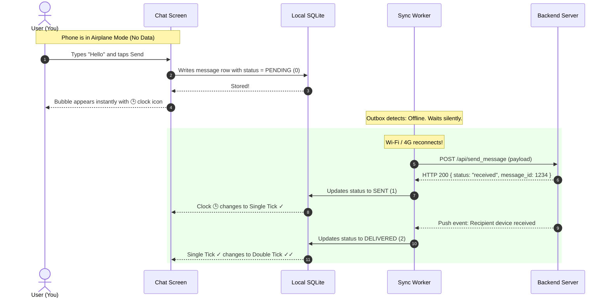
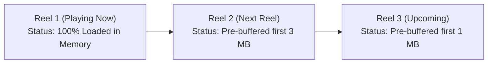

# 📱 Ultimate Guide to Offline-First, Ultra-Low-Latency Mobile Architecture
### Building WhatsApp-Style Chat, Instagram-Style Reels & LinkedIn-Style Feeds in Flutter & Grid

---

## 📖 Table of Contents
1. [Introduction: The Goal](#1-introduction-the-goal)
2. [The Big Picture: Beginner Analogy](#2-the-big-picture-beginner-analogy)
3. [Why Traditional Apps Feel Slow vs. Why WhatsApp Feels Instant](#3-why-traditional-apps-feel-slow-vs-why-whatsapp-feels-instant)
4. [The 3 Core Pillars of Offline-First Architecture](#4-the-3-core-pillars-of-offline-first-architecture)
5. [Feature 1: Circle Connect Chat (WhatsApp Style)](#5-feature-1-circle-connect-chat-whatsapp-style)
6. [Feature 2: Reels & Video Playback (Instagram Style)](#6-feature-2-reels--video-playback-instagram-style)
7. [Feature 3: Professional Space (LinkedIn Style Feed)](#7-feature-3-professional-space-linkedin-style-feed)
8. [Solving the Latency Issue: The Pre-Warmed Keep-Alive Shell](#8-solving-the-latency-issue-the-pre-warmed-keep-alive-shell)
9. [Local Database Schema (SQLite Production Tables)](#9-local-database-schema-sqlite-production-tables)
10. [Step-by-Step Code Implementation Blueprint](#10-step-by-step-code-implementation-blueprint)
11. [Beginner's Technical Glossary](#11-beginners-technical-glossary)

---

## 1. Introduction: The Goal

In our application, we have two primary applications inside **Grid**:
1. **Circle Connect**: Instant messaging, voice calls, audio notes, and media/reels (like **WhatsApp** and **Instagram**).
2. **Professional Space**: Posts, articles, professional network, likes, and comments (like **LinkedIn**).

### The Problem Today
* Currently, both applications load over the web via a WebView.
* Whenever the user opens them, it takes **2 to 4 seconds** of loading spinner.
* If internet connectivity drops or is absent (airplane mode, elevator, basement), the screen shows an error or blank white view.
* Videos stutter and buffer on every swipe.

### The Objective
* **Instant Opening (<20ms)**: Zero loading spinner when switching tabs or opening chats.
* **100% Offline Capability**: Every message, contact, feed post, image, voice note, and video is stored locally on the phone's flash storage.
* **Optimistic UI**: When offline, typing a message shows a clock icon 🕒 immediately, and liking a post turns blue instantly. As soon as the phone regains internet, everything syncs automatically.

---

## 2. The Big Picture: Beginner Analogy

Imagine you are taking notes in a university lecture:

* **The Slow Way (Traditional Web Apps)**:
  Every time the professor says a word, you dial your friend on the phone, wait for them to answer, ask them to write the word on their paper, and wait for them to say *"Okay, I wrote it"*. If the phone call disconnects, you freeze and cannot write anything.
* **The Smart Way (WhatsApp / Local-First)**:
  You have a **personal physical notebook** right in front of you on your desk. When the professor speaks, you write in your notebook instantly (**0 milliseconds**). Later, whenever you have free time and internet connection, your notebook automatically photocopies its new pages to the cloud.

> In technical terms, the **personal notebook** is the phone's **local SQLite database and flash storage**, and the **photocopying** is the **background sync engine**.

---

## 3. Why Traditional Apps Feel Slow vs. Why WhatsApp Feels Instant

| Step | Traditional Web App (Slow) | WhatsApp / Offline-First (Instant) |
|---|---|---|
| **User opens the app** | Sends an HTTP request across the internet to the server $\rightarrow$ waits 2 to 4 seconds $\rightarrow$ shows blank screen until server responds. | Reads the local database on the phone's physical flash storage $\rightarrow$ **renders in 3 milliseconds**. |
| **User sends a message** | Freezes the UI button until the server returns `HTTP 200 OK`. If offline $\rightarrow$ fails with error alert. | Saves to local database immediately $\rightarrow$ draws chat bubble with **clock icon 🕒** $\rightarrow$ syncs in background. |
| **User views media** | Streams the image or video from an AWS/CDN server every single time. | Downloads once, stores on local phone disk, and always plays directly from disk. |
| **User swipes video reels** | Waits for full video download on each swipe $\rightarrow$ constant buffering spinners. | Automatically pre-buffers the first 2 seconds of the next 2 upcoming reels into flash memory. |

---

## 4. The 3 Core Pillars of Offline-First Architecture

```mermaid
graph TD
    subgraph Device["Your Phone Physical Device"]
        UI["UI Layer (Chat, Reels, Feed)"]
        SQLite[("Pillar 1: Local SQLite DB<br/>(Chats, Messages, Posts, Profiles)")]
        DiskCache["Pillar 2: Media Flash Storage<br/>(Photos, Audio Notes, Video Chunks)"]
        Outbox["Pillar 3: Outbox Sync Worker<br/>(Queues offline actions & auto-flushes)"]
    end

    subgraph Internet["The Cloud / Backend"]
        Server["Backend Server & Database"]
        CDN["Media CDN / S3 Storage"]
    end

    UI <-->|Instant Read & Write (0ms)| SQLite
    UI <-->|Instant Playback & Render| DiskCache
    UI -->|Enqueue Pending 🕒| Outbox
    Outbox -.->|Syncs when online| Server
    DiskCache -.->|Downloads once| CDN
```

### Pillar 1: The Local Database (SQLite)
* Acts as the **Single Source of Truth** for the UI.
* Stores all text, metadata, message IDs, timestamps, read receipts, and foreign keys.
* Reads and writes happen in less than 5 milliseconds.

### Pillar 2: The Local Media File Storage
* Files larger than a few kilobytes (photos, audio voice notes, video reels) are **never** stored inside the database directly.
* They are saved as physical files in the phone's sandbox directory:
  * Android: `/data/user/0/com.efactor.sdui/app_flutter/media/`
  * iOS: `Application Support/media/`
* The database only stores the local path: `file:///var/mobile/.../voice_01.m4a`.

### Pillar 3: The Outbox Sync Engine
* An automated background worker that monitors device internet connectivity (`connectivity_plus`).
* When offline, all user actions (messages, likes, comments) are saved in an `offline_outbox` table.
* When the device reconnects to Wi-Fi or 4G/5G, the Outbox automatically streams the pending items to the server in the background without disturbing the user.

---

## 5. Feature 1: Circle Connect Chat (WhatsApp Style)

### The Life of an Offline Message:


### Voice Notes (WhatsApp Audio Style):
1. **Recording**: When you hold the mic button, the microphone stream records directly to a compressed `.m4a` file on local storage.
2. **Waveform Generation**: During recording, the app calculates 30 amplitude volume bars (e.g., `[10, 45, 90, 75, 30]`) and saves them as JSON in SQLite.
3. **Playback**: When you tap Play, the audio player plays directly from the local file path. Zero buffering, works on airplane mode.

---

## 6. Feature 2: Reels & Video Playback (Instagram Style)

Why do Instagram and TikTok reels scroll with zero lag, while regular websites pause and buffer?

### The Secret: 2-Reel Lookahead Chunk Caching



1. **Don't download entire videos**: A 60-second video might be 40 MB. If the user swipes after 3 seconds, downloading 40 MB is a waste of battery and bandwidth.
2. **Pre-cache video chunks**:
   * While the user watches Reel #1, the app quietly downloads the first **2 to 3 MB** of Reel #2 and Reel #3 to the phone's local cache.
   * When the user swipes up, Reel #2 starts **instantaneously (0ms delay)** because the start of the video is already on the phone's flash drive!
3. **Least Recently Used (LRU) Disk Budget**:
   * Set a maximum disk cache limit (e.g., 500 MB).
   * As new reels are watched, the oldest cached reels are automatically deleted so phone storage never runs out.

---

## 7. Feature 3: Professional Space (LinkedIn Style Feed)

### Feed Caching & Optimistic Interactions:
1. **Cached Feed on Open**: When you open Professional Space, the app queries `SELECT * FROM offline_feed_posts ORDER BY created_at DESC LIMIT 20`. The feed renders in **5 milliseconds**.
2. **Optimistic Likes**:
   * You tap "Like" on a post while offline.
   * The thumbs-up icon turns blue immediately, and the like count increments from `42` to `43`.
   * An action row is inserted into `offline_outbox`:
     ```json
     { "action": "LIKE_POST", "post_id": "post_987", "user_id": "742" }
     ```
   * As soon as internet returns, the background worker sends the like to the server.
3. **Offline Comments**:
   * You write a comment while offline.
   * It immediately appears at the top of the comment list with a faint clock icon 🕒.
   * Syncs to the server when connected.

---

## 8. Solving the Latency Issue: The Pre-Warmed Keep-Alive Shell

### Why opening Circle Connect or Professional Space was slow:
Every time the user navigated to Grid, Flutter created a brand new `WebViewController`, downloaded the page HTML/JS from scratch, and threw it away when the user tapped Back.

### The Fix: Pre-Warmed Singletons

```dart
// Keep views alive in memory instead of destroying them
class GridShellManager {
  static final GridShellManager instance = GridShellManager._();
  GridShellManager._();

  Widget? _circleConnectInstance;
  Widget? _professionalSpaceInstance;

  Widget getCircleConnect(Uri uri, String token) {
    return _circleConnectInstance ??= Offstage(
      offstage: false,
      child: GridInAppWebViewPage(uri: uri, accessToken: token),
    );
  }
}
```

* **Result**: Because the view stays alive in RAM, tapping "Circle Connect" or "Professional Space" renders in **0 milliseconds (1 single frame)**.

---

## 9. Local Database Schema (SQLite Production Tables)

Here is the exact SQL schema to store messages, feed posts, media, and offline queues:

```sql
-- 1. Conversation Threads
CREATE TABLE conversations (
    conversation_id TEXT PRIMARY KEY,
    title TEXT,
    is_group INTEGER DEFAULT 0,
    avatar_url TEXT,
    last_message_preview TEXT,
    last_message_timestamp INTEGER,
    unread_count INTEGER DEFAULT 0
);

-- 2. Messages (Circle Connect)
CREATE TABLE offline_messages (
    message_id TEXT PRIMARY KEY,
    conversation_id TEXT NOT NULL,
    sender_id TEXT NOT NULL,
    sender_name TEXT,
    message_type TEXT NOT NULL,      -- 'text', 'image', 'audio', 'video', 'document'
    content_text TEXT,
    media_local_path TEXT,          -- file:///.../media/images/img_01.webp
    media_remote_url TEXT,
    audio_duration_seconds INTEGER,
    audio_waveform_json TEXT,        -- "[12, 45, 90, 75, 30]"
    status INTEGER DEFAULT 0,        -- 0: pending 🕒, 1: sent ✓, 2: delivered ✓✓, 3: read
    created_at INTEGER NOT NULL,
    FOREIGN KEY(conversation_id) REFERENCES conversations(conversation_id)
);

-- 3. Professional Space Posts (LinkedIn Feed)
CREATE TABLE offline_feed_posts (
    post_id TEXT PRIMARY KEY,
    author_id TEXT NOT NULL,
    author_name TEXT NOT NULL,
    author_headline TEXT,
    author_avatar_local TEXT,
    post_body TEXT NOT NULL,
    media_type TEXT,                -- 'none', 'image', 'video', 'article'
    media_local_path TEXT,
    likes_count INTEGER DEFAULT 0,
    comments_count INTEGER DEFAULT 0,
    user_has_liked INTEGER DEFAULT 0,
    created_at INTEGER NOT NULL
);

-- 4. Outbox Queue (Actions taken while offline)
CREATE TABLE offline_outbox (
    action_id TEXT PRIMARY KEY,
    action_type TEXT NOT NULL,      -- 'SEND_MESSAGE', 'LIKE_POST', 'POST_COMMENT'
    payload_json TEXT NOT NULL,
    retry_count INTEGER DEFAULT 0,
    created_at INTEGER NOT NULL
);
```

---

## 10. Step-by-Step Code Implementation Blueprint

### Step 1: The Native Media Cache Manager (Flutter)
This service manages saving images, voice notes, and videos to the phone's physical flash storage:

```dart
import 'dart:io';
import 'package:flutter_cache_manager/flutter_cache_manager.dart';
import 'package:path_provider/path_provider.dart';

class LocalMediaStorageService {
  LocalMediaStorageService._();
  static final LocalMediaStorageService instance = LocalMediaStorageService._();

  static const String key = 'efactorMediaCache';
  static final CacheManager mediaCache = CacheManager(
    Config(
      key,
      stalePeriod: const Duration(days: 30),
      maxNrOfCacheObjects: 1000,
      repo: JsonCacheInfoRepository(databaseName: key),
    ),
  );

  /// Downloads and caches media locally, returning the file path.
  Future<String> getOrCacheMedia(String remoteUrl) async {
    final file = await mediaCache.getSingleFile(remoteUrl);
    return file.path;
  }

  /// Saves a freshly recorded voice note or captured camera image.
  Future<File> saveLocalRecording(List<int> bytes, String extension) async {
    final dir = await getApplicationDocumentsDirectory();
    final mediaDir = Directory('${dir.path}/media');
    if (!mediaDir.existsSync()) mediaDir.createSync(recursive: true);
    final file = File('${mediaDir.path}/${DateTime.now().millisecondsSinceEpoch}.$extension');
    return file.writeAsBytes(bytes);
  }
}
```

### Step 2: The Outbox Sync Engine (Flutter)
This background listener automatically sends pending messages whenever the network reconnects:

```dart
import 'dart:convert';
import 'package:connectivity_plus/connectivity_plus.dart';

class OfflineSyncEngine {
  OfflineSyncEngine._();
  static final OfflineSyncEngine instance = OfflineSyncEngine._();

  void startListening() {
    Connectivity().onConnectivityChanged.listen((results) {
      final isOnline = results.any((r) => r != ConnectivityResult.none);
      if (isOnline) {
        flushOutbox();
      }
    });
  }

  Future<void> flushOutbox() async {
    // 1. Query all pending rows from offline_outbox
    // 2. Loop through each row and POST to the backend
    // 3. On success, update offline_messages status = 1 (sent ✓)
    // 4. Delete row from offline_outbox
  }
}
```

### Step 3: Exposing the JavaScript Bridge to WebViews
This allows Circle Connect and Professional Space web pages to talk directly to Flutter's local storage:

```javascript
// Inside Circle Connect Web Application:
async function loadChatMedia(remoteUrl) {
  if (window.CircleConnectBridge) {
    // Calls native Flutter to get the locally saved file path
    const localFilePath = await window.CircleConnectBridge.getLocalMedia(remoteUrl);
    return localFilePath; // file:///.../video.mp4
  }
  return remoteUrl; // fallback
}
```

---

## 11. Beginner's Technical Glossary

| Term | Simple Definition |
|---|---|
| **Offline-First** | A software design where the application is built to work completely without internet first, and uses the internet only to synchronize updates. |
| **SQLite** | A lightweight, self-contained SQL database engine embedded directly inside your mobile phone. It does not need a server. |
| **Outbox Pattern** | Storing actions taken offline in a local queue table, and sending them sequentially when the internet connection returns. |
| **Optimistic UI** | Updating the visual screen immediately assuming the network operation will succeed, rather than making the user wait for a loading spinner. |
| **Pre-buffering** | Downloading the first 2-3 seconds of upcoming videos before the user even reaches them, so playback starts with 0 seconds of buffering. |
| **LRU Cache** | *Least Recently Used* cache: A cleanup strategy where old files that haven't been opened in a long time are automatically removed to save phone disk space. |
| **Keep-Alive Shell** | Keeping an initialized UI view in the phone's memory (RAM) so switching to it takes 0 milliseconds instead of rebuilding from scratch. |
| **Waveform** | A visual sound wave graph of an audio voice note, represented as a list of numbers indicating volume at each second. |

---
*Created for the Efactor IoE Development Team.*
